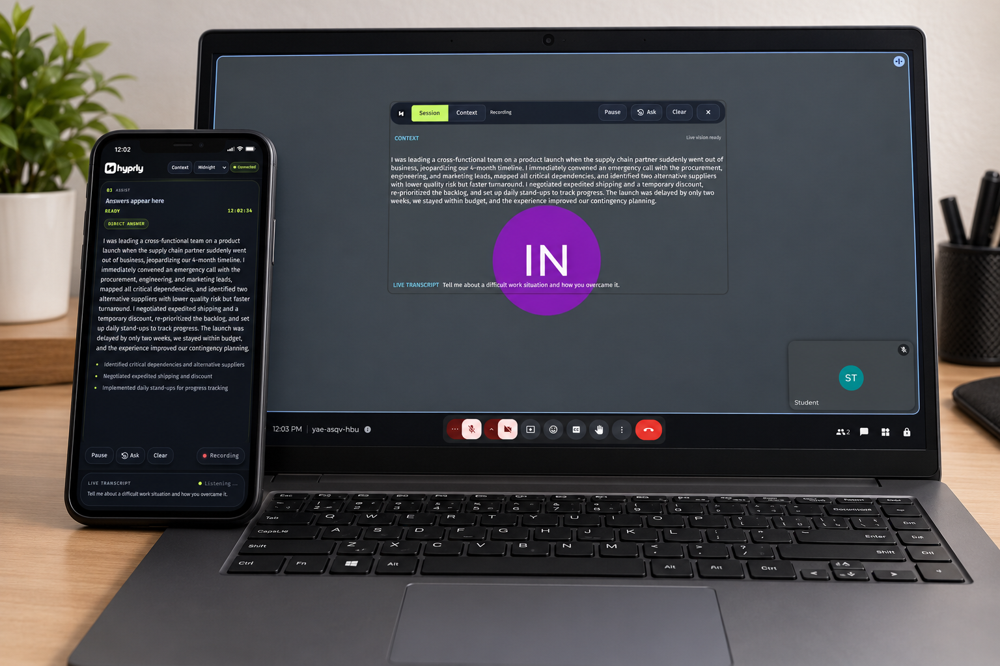
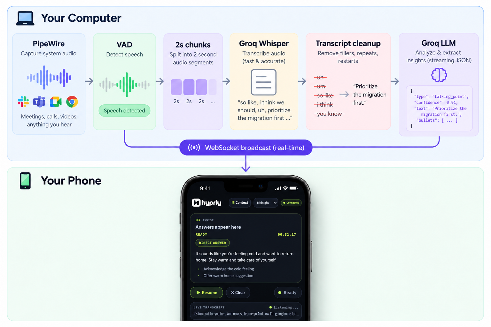
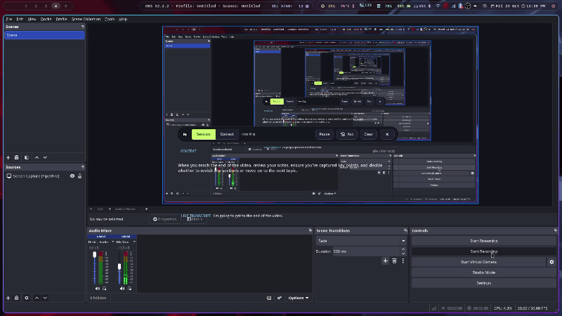
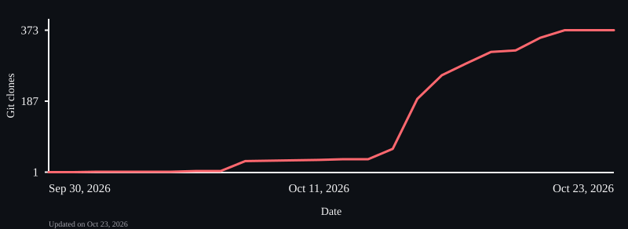

<div align="center">

<picture>
  <source media="(prefers-color-scheme: dark)" srcset="assets/logo_text_white.png">
  
</picture>

### Private meeting audio, with answers on your phone.

[](LICENSE)
[](https://www.rust-lang.org/)
[](https://pipewire.org/)

</div>

Hyprly is a Linux desktop app that captures meeting audio through PipeWire, transcribes it with Groq Whisper, and streams AI answers to a phone browser. Audio is processed in memory and is not saved to disk.

<p align="center">
  
</p>

<div align="center">
  <h1>⚠️ Hyprland floating overlay warning ⚠️</h1>
</div>

Hyprly's floating overlay can stay visible on your desktop while remaining hidden from screen shares with the Hyprland patch enabled. This behavior is confirmed on **Hyprland 0.56.2** and **Hyprland 0.57.0**.

The Arch installer, [install-arch.sh](install-arch.sh), builds and installs a patched Hyprland package through pacman. It uses [PR #16061](https://github.com/hyprwm/Hyprland/commit/eb4edf1cd20ae02cae8c83b819cd8e59100572c) for Hyprland 0.56.2 and [PR #16638](https://github.com/hyprwm/Hyprland/pull/16638) for Hyprland 0.57.0. The installer checks the installed Hyprland version and only supports these two releases. Log out and start a new Hyprland session to activate the change. A future Hyprland update may replace the patched package or require an updated patch port.

It takes around 30 minutes, depending on your CPU, to build and install the patched Hyprland.

## How it works





## Features

- GTK4 desktop app
- PipeWire audio capture
- Groq Whisper transcription
- Streaming AI answers
- QR code and six-digit phone pairing
- Local HTTPS connection
- Midnight, Paper, and Aurora themes
- PDF and DOCX interview context
- On-demand screen reading with Groq vision
- System tray controls
- No audio saved to disk

## Requirements

- Linux with GTK4, PipeWire, WirePlumber, and `grim`
- Rust and Cargo to build from source (Cargo is included with Rust)
- A [Groq API key](https://console.groq.com/keys)
- A phone browser on the same local network

Install the dependencies and build tools with your distribution's package manager:

**Arch Linux**

```bash
sudo pacman -S --needed base-devel git gtk4 pipewire wireplumber grim rust openssl pkgconf
```

**Debian / Ubuntu**

```bash
sudo apt update
sudo apt install build-essential git libgtk-4-dev libssl-dev pkg-config pipewire wireplumber grim rustc cargo
```

## Build and run


```bash
git clone https://github.com/patermars/Hyprly.git
cd Hyprly
```
To build and temporarily run Hyprly from the project directory:
```bash
cargo run --release
```

`cargo run --release` does not install Hyprly. 

To install it as a native Arch package, run this from the project root:

```bash
./install-arch.sh
```

## Clone history



## License

[MIT](LICENSE) — © 2026 Aryan Kumar Sinha

## Contributing

Feel free to raise a pull request and contribute to Hyprly. Contributions and feedback are welcome!
